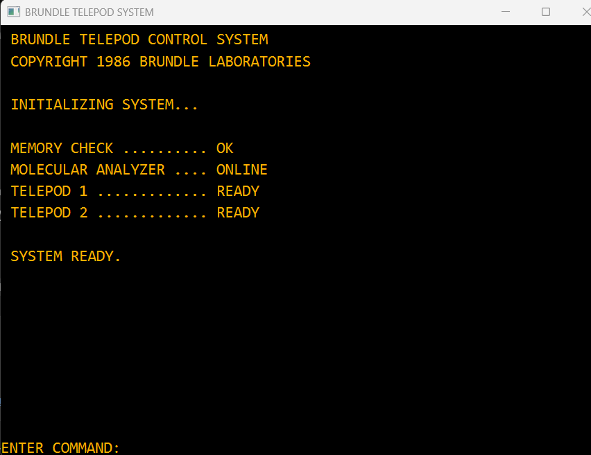

# Brundle Telepod System

A JavaFX telepod simulation inspired by the film *The Fly*.
This personal project combines Java programming with a
terminal-style interface.

## Technologies
- Java
- JavaFX
- CSS

## Available Commands
- `help`
- `status`
- `version`
- `load`
- `unload`
- `scan`
- `teleport`
- `return`
- `diagnostics`

## Requirements
Java Development Kit (JDK) and JavaFX SDK.
JavaFX must be configured for your local environment.

## Project Status
Work in progress. Additional features and improvements are planned.

## Screenshot



## How to Run in VS Code (Windows)

### Tested Setup
- OpenJDK 25.0.4.1 (Eclipse Temurin)
- JavaFX SDK 25.0.4
- VS Code with Extension Pack for Java

### Setup
1. Install the JDK and extract the JavaFX SDK.
2. Download or clone this repository and open its folder in VS Code.
3. Create a `.vscode` folder in the project folder.
4. Create the following two files inside `.vscode`.

These examples assume JavaFX is installed at
`C:/javafx/javafx-sdk-25.0.4`. Change both paths if yours differs.

**settings.json**
```json
{
    "java.project.referencedLibraries": [
        "C:/javafx/javafx-sdk-25.0.4/lib/*.jar"
    ]
}
```

**launch.json**
```json
{
    "version": "0.2.0",
    "configurations": [
        {
            "type": "java",
            "name": "Launch Brundle Telepod System",
            "request": "launch",
            "mainClass": "BrundleTelepodSystem",
            "vmArgs": "--module-path \"C:/javafx/javafx-sdk-25.0.4/lib\" --add-modules javafx.controls"
        }
    ]
}
```

### Launch
Open Run and Debug in VS Code, select
**Launch Brundle Telepod System**, and press **F5**.

Enter `help` in the application to see the available commands.

The `.vscode` folder is excluded from Git because its paths
depend on each user's computer.